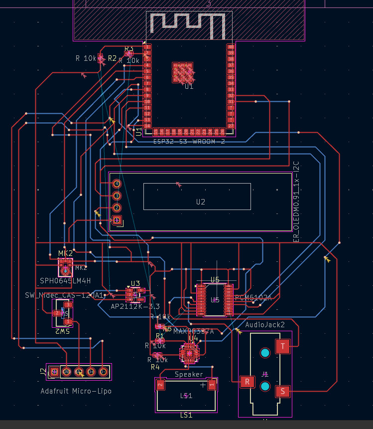

# Live Translating Device

A compact, custom-designed hardware PCB for a real-time live translating device powered by an **ESP32** microcontroller and an onboard **MAX98351/A** I2S audio amplifier. Designed and routed in KiCad, this board processes live audio and delivers translated speech directly through an external speaker output.

---

## 🚀 Features

* **Real-Time Speech Processing:** Powered by an ESP32 microcontroller handling wireless connectivity and audio data pipelines.
* **I2S Audio Output:** Onboard Maxim Integrated MAX98351/A Class-D digital audio amplifier driving speaker playback.
* **Thermal & Power Optimization:** Multi-layer PCB design featuring an optimized thermal ground pad array and dedicated power planes to reduce switching noise.
* **Manufacturing Ready:** Verified KiCad DRC configuration tailored for seamless fabrication with PCBWay.

---

